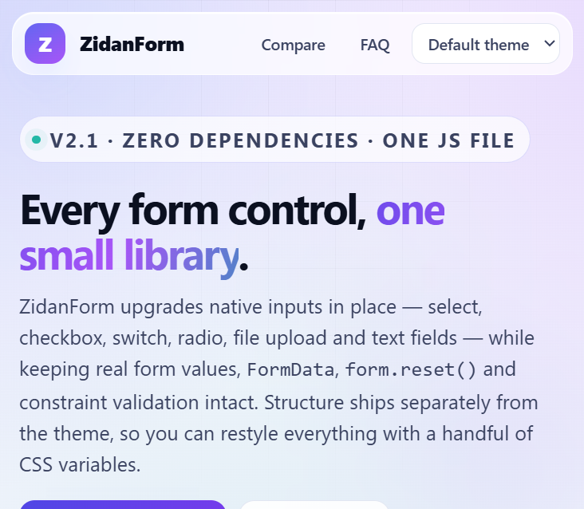

# ZidanForm

Zero-dependency form enhancement for the browser. Upgrade native `<select>`, checkbox,
switch, radio, file and text inputs **in place** — real form values, `FormData`,
`form.reset()` and constraint validation keep working, while structure and theme live in
two separate stylesheets.

[](https://akhtar1985.github.io/zidan-select/)
[](https://www.npmjs.com/package/zidan-select)
[](https://akhtar1985.github.io/zidan-select/docs/options.html)
[](https://github.com/akhtar1985/zidan-select/blob/main/LICENSE)

## Which files should you load?

> **You do not need to load everything.** Each build is complete and standalone — pick the one
> that matches your page. The full bundle is only for forms that enhance several inputs at once.

- **Only custom select dropdowns** — load **only** the select build's JavaScript and CSS. You do
  not need the full form bundle if you only want styled `<select>` elements.
- **Only file upload inputs** — load **only** the file upload build's JavaScript and CSS if you
  only want custom file pickers and want the rest of your form left untouched.
- **All form inputs at once** — load the **complete form bundle** (full JavaScript and CSS) to
  style and enhance every supported input across your form: text fields, selects, file uploads,
  checkboxes and radios.

Load **one** build per page. A subset is not an add-on: never load it together with the full
bundle.

Sizes measure the current source build; CDN links pin the 2.5.0 release.

| Build | JavaScript size | JavaScript (CDN) | CSS (CDN) |
| --- | --- | --- | --- |
| Full — every control | ≈299 kB raw · ≈172 kB minified | [zidan-form.js](https://cdn.jsdelivr.net/npm/zidan-select@2.5.0/zidan-form.js) | [plugin-core.css](https://cdn.jsdelivr.net/npm/zidan-select@2.5.0/plugin-core.css) + [plugin-theme.css](https://cdn.jsdelivr.net/npm/zidan-select@2.5.0/plugin-theme.css) |
| Select-only | ≈149 kB raw · ≈86 kB minified | [zidan-select.js](https://cdn.jsdelivr.net/npm/zidan-select@2.5.0/dist/select/zidan-select.js) | [plugin-select-core.css](https://cdn.jsdelivr.net/npm/zidan-select@2.5.0/dist/select/plugin-select-core.css) + [plugin-select-theme.css](https://cdn.jsdelivr.net/npm/zidan-select@2.5.0/dist/select/plugin-select-theme.css) |
| File-only | ≈121 kB raw · ≈70 kB minified | [zidan-file.js](https://cdn.jsdelivr.net/npm/zidan-select@2.5.0/dist/file/zidan-file.js) | [plugin-file-core.css](https://cdn.jsdelivr.net/npm/zidan-select@2.5.0/dist/file/plugin-file-core.css) + [plugin-file-theme.css](https://cdn.jsdelivr.net/npm/zidan-select@2.5.0/dist/file/plugin-file-theme.css) |

Copyable snippets, ESM files and per-file sizes live in
[Select-only and file-only builds](#select-only-and-file-only-builds); the
[live demo](https://akhtar1985.github.io/zidan-select/#builds) shows all three side by side.

**Build a field visually:** the [field playground](https://akhtar1985.github.io/zidan-select/playground.html)
exposes the main options for one control, previews them live and copies supported HTML attributes
or the equivalent vanilla JavaScript; the [API lab](https://akhtar1985.github.io/zidan-select/#lab)
covers the complete option, callback, method and event inventory.

### Minified CDN URLs

These are real minified files shipped in the npm package, so jsDelivr and unpkg serve the
same pinned bytes:

| Build | JS (min) | CSS (min) |
| --- | --- | --- |
| Full | [zidan-form.min.js](https://cdn.jsdelivr.net/npm/zidan-select@2.5.0/dist/zidan-form.min.js) — ≈172 kB | [plugin-core.min.css](https://cdn.jsdelivr.net/npm/zidan-select@2.5.0/dist/plugin-core.min.css) — ≈33 kB + [plugin-theme.min.css](https://cdn.jsdelivr.net/npm/zidan-select@2.5.0/dist/plugin-theme.min.css) — ≈44 kB |
| Select-only | [zidan-select.min.js](https://cdn.jsdelivr.net/npm/zidan-select@2.5.0/dist/select/zidan-select.min.js) — ≈86 kB | [plugin-select-core.min.css](https://cdn.jsdelivr.net/npm/zidan-select@2.5.0/dist/select/plugin-select-core.min.css) — ≈10 kB + [plugin-select-theme.min.css](https://cdn.jsdelivr.net/npm/zidan-select@2.5.0/dist/select/plugin-select-theme.min.css) — ≈29 kB |
| File-only | [zidan-file.min.js](https://cdn.jsdelivr.net/npm/zidan-select@2.5.0/dist/file/zidan-file.min.js) — ≈70 kB | [plugin-file-core.min.css](https://cdn.jsdelivr.net/npm/zidan-select@2.5.0/dist/file/plugin-file-core.min.css) — ≈7 kB + [plugin-file-theme.min.css](https://cdn.jsdelivr.net/npm/zidan-select@2.5.0/dist/file/plugin-file-theme.min.css) — ≈34 kB |

- **One file of JS** — `zidan-form.js` (classic script, UMD-ish) + `zidan-form.mjs` (ESM wrapper).
- **Split CSS** — `plugin-core.css` (structure only) and `plugin-theme.css` (tokens, presets, skins).
- **Opt-in per control** — nothing is touched unless it carries a `data-zidan*` attribute or is
  passed to the API.
- **Native-first** — the real input stays in the DOM at 1×1 px (never `display:none`), so
  `FormData`, `reset()`, `required`, `:invalid` and jQuery Validation's `:hidden` ignore behave.
- **6 themes** `default · modern · minimal · dark · glass · auto`; `auto` follows the OS
  colour scheme through `prefers-color-scheme`.
- **Large lists** — opt-in virtual window (`virtual: 'auto'`), accent-insensitive search,
  `<mark>` match highlighting and native type-ahead for non-searchable selects.
- **i18n** — bundled `en · es · fr · de · ar` copy packs, `<html lang>` detection and
  `ZidanSelect.locales` for custom packs.
- **5 select layouts** `classic-clean · floating-label · soft-pill · bordered-brutalist · glass-elevated`.
- **Field layouts** `stacked · inline · compact · floating · outlined · card`.
- **Framework adapters** standalone, Bootstrap 5, Tailwind CSS, Bulma, Foundation.
- **Input add-ons (2.1)** — opt-in icons for any input type, a − / + number stepper in three
  modes, phone formatting (national / international / E.164, caret-safe), rich range skins
  with ticks/bubble/formatters, weekend/date rules and a full upload pipeline.
- **Input masks & autogrow (2.5)** — `#`/`A`/`*` masks with auto literals and caret repair,
  plus textareas that grow to their content and stop at `autogrowMax`.
- **Tags & multi helpers (2.5)** — drag or Alt+Arrow tag reordering, F2/double-click inline
  renaming, and `selectAll` / `deselectAll` / `toggleAll` / `areAllSelected` / `getSelectedItems`.
- **Form helpers (2.5)** — `ZidanForm.serialize(form)` (arrays for repeated names),
  `ZidanForm.validate(form)` (field rules + native validity, first-invalid focus), and
  `ZidanForm.destroy(root)` / `ZidanSelect.destroy(root)` scoped teardown for component
  frameworks.
- **More skins** — checkbox `default · switch · card · button · minimal`; five switch styles
  (`ios · material · square · labeled · icon`); radio `stacked · inline · card · button · tile`
  with click-to-deselect; file `dropzone · button · avatar · gallery · compact`.
- **Upload API** — `simulateUpload`, custom `upload()` handler or XHR with method, params,
  headers, timeout, response paths, automatic retries and a concurrency queue; progress, cancel,
  `whenUploaded()`, `getUploadState()`, `removeFiles()` and per-file `renderFile` hook.
- **Phone picker & image downscale (2.5)** — a searchable country menu instead of a long native
  list, and `downscale` / `ZidanForm.downscaleImage()` to resize images in the browser before
  upload.
- **Async validation (2.3)** — Promise-returning rules with a pending spinner, abort on
  change, stale-result guards and native submit blocking.
- **Remote pagination (2.3)** — paged `fetchOptions`, cached pages, load-more button and
  scroll auto-load with a retryable error state.
- **RTL & TypeScript (2.3)** — logical-property layout with mirrored transforms, plus
  hand-written declarations for the full and subset builds.
- WAI-ARIA labels, focus management, keyboard support throughout, `prefers-reduced-motion`.

---

## Why ZidanForm

Most form libraries fix one control. ZidanForm upgrades the whole form with the same API,
the same two stylesheets and no dependencies.

| | ZidanForm | Select2 | Choices.js | Tom Select | Slim Select |
| --- | --- | --- | --- | --- | --- |
| Runtime dependencies | **None** | jQuery | None | None | None |
| Controls covered | **Select, checkbox, switch, radio, file, text, phone, stepper, range, date/time** | Select / tags | Select, text, tags | Select / tags | Select |
| Input icons & adornments | **Auto, custom SVG, left/right, clickable** | — | — | — | — |
| Phone number formatting | **Per country, 3 styles each** | — | — | — | — |
| Number stepper & range skins | **3 stepper layouts, 3 range skins** | — | — | — | — |
| File upload variants & progress | **Dropzone, button, avatar, gallery, compact** | — | — | — | — |
| Text input utilities | **Clear, reveal, prefix/suffix, counter** | — | — | — | — |
| Built-in validation rules | **Every type, date rules, async Promise rules, validation icons** | — | — | — | — |
| Remote / paged option loading | **Yes — cached, load-more, scroll auto-load** | AJAX adapter | — | `load()` callback | — |
| RTL layout | **Yes, logical properties** | Yes | Yes | Yes | Partial |
| TypeScript declarations | **Yes, full + both subsets** | Community | Bundled | Bundled | Bundled |
| Split structure / theme CSS | **Yes** | Partial | Partial | Partial | Partial |
| Select-only / file-only builds | **Yes, with matching CSS** | Core is select-only | Core is select + text | Core is select-only | Core is select-only |
| Validation coexistence tested | **Native, jQuery Validation, JustValidate, Parsley** | — | — | — | — |
| CSS-framework adapters | **Bootstrap, Tailwind, Bulma, Foundation** | — | — | — | — |
| Framework support | **React, Next.js, Vue, Svelte, Angular guides** | Community wrappers | Community wrappers | Community wrappers | Community wrappers |

**Benefits**

- **One library for every control** — no mix of Select2 + Dropzone + custom checkbox CSS.
- **Native behavior survives** — `FormData`, `reset()`, `required`, `:invalid` and
  `input.files` keep working because the real control is never `display:none`.
- **Themeable without forking** — structure lives in `plugin-core.css`, colours and skins in
  `plugin-theme.css`; five presets plus your own tokens.
- **Fits existing validation** — jQuery Validation, JustValidate, Parsley and native HTML5 are
  documented and tested, with `aria-invalid` sync and double-submit guards.
- **Opt-in and reversible** — enhance only `data-zidan*` controls; `destroy()` restores markup.
- **No build step** — classic script, ESM wrapper and plain CSS.

**Trade-offs:** smaller community than Select2, no React/Vue component package, and for very
complex comboboxes (tokenized multi-search, virtualised remote tag editors) Select2 or Tom
Select still have deeper ecosystems. Full matrix, honest limitations and migration notes:
**[`docs/comparison.md`](https://akhtar1985.github.io/zidan-select/docs/comparison.html)**.

---

## Contents

1. [Live demo](#live-demo)
2. [Install](#install)
3. [Select-only & file-only builds](#select-only-and-file-only-builds)
4. [Why ZidanForm](#why-zidanform)
5. [Quick start](#quick-start)
6. [Input types](#input-types)
7. [Options & data attributes](#options--data-attributes)
8. [Remote data (AJAX)](#remote-data-ajax-selects)
9. [JavaScript API](#javascript-api)
10. [Themes, layouts & frameworks](#themes-layouts--frameworks)
11. [Validation libraries](#validation-libraries)
12. [Form lifecycle & state sync](#form-lifecycle--state-sync)
13. [React, Next.js, Vue, Svelte, Angular](#react-nextjs-vue-svelte-angular)
14. [Build & publish](#build--publish)
15. [Browser support](#browser-support)
16. [What's new in 2.1–2.5](#whats-new-in-215)
17. [Migrating from 1.x](#migrating-from-1x)

---

## Live demo

[](https://akhtar1985.github.io/zidan-select/)

**Demo:** <https://akhtar1985.github.io/zidan-select/> — deployed from `main` by
[`.github/workflows/pages.yml`](https://github.com/akhtar1985/zidan-select/blob/main/.github/workflows/pages.yml) on every push.

Deep links open the matching tab:

| Tab | Direct link |
| --- | --- |
| All inputs | <https://akhtar1985.github.io/zidan-select/#all> |
| Select / combobox / tags | <https://akhtar1985.github.io/zidan-select/#select> |
| Checkbox, switch & radio | <https://akhtar1985.github.io/zidan-select/#check> |
| File upload variants & progress | <https://akhtar1985.github.io/zidan-select/#file> |
| Icons, stepper, phone, range, date & time | <https://akhtar1985.github.io/zidan-select/#inputs> |
| Themes & layouts | <https://akhtar1985.github.io/zidan-select/#themes> |

The page also has a live **event console** (below the tabs) that shows every `zidan:*` event as
you interact, and the **Embed & share** tab for copying snippets.

A mock **Shopify product page** — variant combobox, quantity stepper, gift-wrap switch, tile
radios, upload dropzone and the Liquid install snippets — runs at
<https://akhtar1985.github.io/zidan-select/shopify.html>.

A dedicated **[AJAX & remote data demo](https://akhtar1985.github.io/zidan-select/ajax.html)** wires
`data-zidan-fetch-url` to a real API and shows the hand-written `fetchOptions` contract with live
paging, abort and cache state. The **[API request lab](https://akhtar1985.github.io/zidan-select/api.html)**
adds custom headers, extra query parameters, JSON POST bodies and the remote instance methods, with
the exact request visible as it is built.

Below the tabs sits the **[controls reference]**(https://akhtar1985.github.io/zidan-select/#controls)**
— all nine control families on one page with the options you reach for most, the two ways to
initialise a field and copyable examples, linking into the playground for the rest.

---

## Install

### npm

```bash
npm install zidan-select
```

```js
// ESM
import ZidanForm, { initZidanForms, initZidanSelects, zidanField } from 'zidan-select';
import 'zidan-select/css/core';
import 'zidan-select/css/theme';
```

```js
// CommonJS
const { ZidanForm, initZidanForms, initZidanSelects } = require('zidan-select');
```

```js
// Select-only or file-only bundles (matching JS + CSS)
import { ZidanSelect } from 'zidan-select/select';
import 'zidan-select/select/css/core';
import 'zidan-select/select/css/theme';

import { ZidanFileUpload, zidanField } from 'zidan-select/file';
import 'zidan-select/file/css/core';
import 'zidan-select/file/css/theme';
```

### CDN

```html
<link rel="stylesheet" href="https://cdn.jsdelivr.net/npm/zidan-select@2/plugin-core.css">
<link rel="stylesheet" href="https://cdn.jsdelivr.net/npm/zidan-select@2/plugin-theme.css">
<script src="https://cdn.jsdelivr.net/npm/zidan-select@2/zidan-form.js"></script>
```

`plugin-core.css` must come first. Load your own theme file *after* `plugin-theme.css` to
override presets.

### Files

| File | Purpose |
| --- | --- |
| `zidan-form.js` | All controls. Classic `<script>` → `window.ZidanForm` (+ legacy `window.ZidanSelect`). |
| `zidan-form.mjs` | ES module wrapper around the same file. |
| `plugin-core.css` | Layout, positioning, native-input handling, mechanics. **No colours, shadows or skins.** |
| `plugin-theme.css` | Tokens, colours, states, presets, layout skins, framework adapters. |
| `dist/select/` | Select-only build: `zidan-select.js`, `zidan-select.mjs`, `plugin-select-core.css`, `plugin-select-theme.css`. |
| `dist/file/` | File-only build: `zidan-file.js`, `zidan-file.mjs`, `plugin-file-core.css`, `plugin-file-theme.css`. |
| `index.html`, `demo.css`, `demo.js` | The tabbed demo / theme showcase plus the controls reference section (not shipped logic). |
| `advanced.html`, `advanced.css`, `advanced.js` | Advanced reference: init and precedence, async paging, Promise validation, uploads, events, RTL and TypeScript, with copyable HTML/JS examples (not shipped logic). |
| `playground.html`, `playground.css`, `playground.js` | Per-field option builder with live preview and copyable HTML / JS output (not shipped logic). |
| `api.html`, `api.css`, `api.js` | Request lab for headers, params, JSON bodies and response paths, with a deterministic POST mock (not shipped logic). |
| `ajax.html`, `ajax.css`, `ajax.js` | Declarative remote GET and hand-written `fetchOptions` with paging, abort and retry (not shipped logic). |
| `nav.css`, `nav.js` | Shared header, navigation and mobile menu button for the demo pages (not shipped logic). |
| `robots.txt`, `sitemap.xml` | Crawler directives and the public page list for GitHub Pages (not shipped on npm). |
| `docs/` | Comparison, options, validation, frameworks, theming, build and the static HTML/WordPress cookbook. |

Copyable URLs for the published files (pin the version in production):

- `zidan-form.js` — <https://cdn.jsdelivr.net/npm/zidan-select@2.5.0/zidan-form.js>
- `zidan-form.min.js` — <https://cdn.jsdelivr.net/npm/zidan-select@2.5.0/dist/zidan-form.min.js>
- `zidan-form.mjs` — <https://cdn.jsdelivr.net/npm/zidan-select@2.5.0/zidan-form.mjs>
- `plugin-core.css` — <https://cdn.jsdelivr.net/npm/zidan-select@2.5.0/plugin-core.css>
- `plugin-core.min.css` — <https://cdn.jsdelivr.net/npm/zidan-select@2.5.0/dist/plugin-core.min.css>
- `plugin-theme.css` — <https://cdn.jsdelivr.net/npm/zidan-select@2.5.0/plugin-theme.css>
- `plugin-theme.min.css` — <https://cdn.jsdelivr.net/npm/zidan-select@2.5.0/dist/plugin-theme.min.css>
- npm package — <https://www.npmjs.com/package/zidan-select>
- Source — <https://github.com/akhtar1985/zidan-select>

The demo page loads these same four files from the repository root, so it always exercises the
exact code that ships.

### Select-only and file-only builds

Only need one control family? Load a trimmed bundle instead of the full library. Each bundle
ships matching structure and theme stylesheets and keeps the five preset themes, the layouts and
the Bootstrap, Tailwind, Bulma and Foundation adapters, so theme and framework attributes behave
exactly like the full build.

| Build | JS | ESM | Core CSS | Theme CSS |
| --- | --- | --- | --- | --- |
| Select / combobox / tags | `dist/select/zidan-select.js` | `dist/select/zidan-select.mjs` | `dist/select/plugin-select-core.css` | `dist/select/plugin-select-theme.css` |
| File upload | `dist/file/zidan-file.js` | `dist/file/zidan-file.mjs` | `dist/file/plugin-file-core.css` | `dist/file/plugin-file-theme.css` |

Copyable CDN URLs (pin the version):

- `zidan-select.js` — <https://cdn.jsdelivr.net/npm/zidan-select@2.5.0/dist/select/zidan-select.js>
- `zidan-select.min.js` — <https://cdn.jsdelivr.net/npm/zidan-select@2.5.0/dist/select/zidan-select.min.js>
- `zidan-select.mjs` — <https://cdn.jsdelivr.net/npm/zidan-select@2.5.0/dist/select/zidan-select.mjs>
- `plugin-select-core.css` — <https://cdn.jsdelivr.net/npm/zidan-select@2.5.0/dist/select/plugin-select-core.css>
- `plugin-select-core.min.css` — <https://cdn.jsdelivr.net/npm/zidan-select@2.5.0/dist/select/plugin-select-core.min.css>
- `plugin-select-theme.css` — <https://cdn.jsdelivr.net/npm/zidan-select@2.5.0/dist/select/plugin-select-theme.css>
- `plugin-select-theme.min.css` — <https://cdn.jsdelivr.net/npm/zidan-select@2.5.0/dist/select/plugin-select-theme.min.css>
- `zidan-file.js` — <https://cdn.jsdelivr.net/npm/zidan-select@2.5.0/dist/file/zidan-file.js>
- `zidan-file.min.js` — <https://cdn.jsdelivr.net/npm/zidan-select@2.5.0/dist/file/zidan-file.min.js>
- `zidan-file.mjs` — <https://cdn.jsdelivr.net/npm/zidan-select@2.5.0/dist/file/zidan-file.mjs>
- `plugin-file-core.css` — <https://cdn.jsdelivr.net/npm/zidan-select@2.5.0/dist/file/plugin-file-core.css>
- `plugin-file-core.min.css` — <https://cdn.jsdelivr.net/npm/zidan-select@2.5.0/dist/file/plugin-file-core.min.css>
- `plugin-file-theme.css` — <https://cdn.jsdelivr.net/npm/zidan-select@2.5.0/dist/file/plugin-file-theme.css>
- `plugin-file-theme.min.css` — <https://cdn.jsdelivr.net/npm/zidan-select@2.5.0/dist/file/plugin-file-theme.min.css>

Select / combobox / tags only (≈149 kB raw / ≈86 kB minified JS, ≈13 → 10 kB core CSS,
≈34 → 29 kB theme CSS):

```html
<link rel="stylesheet" href="https://cdn.jsdelivr.net/npm/zidan-select@2.5.0/dist/select/plugin-select-core.css">
<link rel="stylesheet" href="https://cdn.jsdelivr.net/npm/zidan-select@2.5.0/dist/select/plugin-select-theme.css">
<script src="https://cdn.jsdelivr.net/npm/zidan-select@2.5.0/dist/select/zidan-select.js"></script>
<script>
  // auto-init covers [data-zidan-select], class="zidan-select", zidan-form scopes
  // and ZIDAN_FORM_CONFIG targets; JS-only options:
  zidanSelect('#country', { mode: 'select' });
</script>
```

File upload only (≈121 kB raw / ≈70 kB minified JS, ≈10 → 7 kB core CSS,
≈39 → 34 kB theme CSS):

```html
<link rel="stylesheet" href="https://cdn.jsdelivr.net/npm/zidan-select@2.5.0/dist/file/plugin-file-core.css">
<link rel="stylesheet" href="https://cdn.jsdelivr.net/npm/zidan-select@2.5.0/dist/file/plugin-file-theme.css">
<script src="https://cdn.jsdelivr.net/npm/zidan-select@2.5.0/dist/file/zidan-file.js"></script>
<script>
  zidanField('#upload', { variant: 'dropzone', uploadUrl: '/api/files' });
</script>
```

Framework and theme options are unchanged: `data-zidan-framework="bootstrap|tailwind|bulma|foundation"`,
`data-zidan-theme`, `data-zidan-layout` and the framework adapter CSS all ship in each subset.
Load a subset **instead of** `zidan-form.js`, not together with it — the guard keeps the first
initialised copy. If one page needs select *and* file upload, use the full build. The select
bundle exposes `ZidanSelect`, `zidanSelect`, `initZidanSelects`; the file bundle exposes
`ZidanFileUpload`, `zidanField`, `initZidanForms`.

Declarative init ships in both subsets too: `class="zidan-select"` (or a `zidan-form` wrapper)
works with no JS in the select build, and `class="zidan-field"` / a `zidan-form` wrapper works
with no JS in the file build. The same [`window.ZIDAN_FORM_CONFIG`](#no-javascript-init-ids-classes--json-cms-friendly)
targets apply.

---

## Quick start

> Building a plain HTML page, a WordPress site or a page-builder embed? The
> [static HTML & WordPress cookbook](https://akhtar1985.github.io/zidan-select/docs/html-and-wordpress.html) has complete copy-paste pages
> (full, select-only, file-only, ID/class targeting, `functions.php` enqueue).

```html
<link rel="stylesheet" href="plugin-core.css">
<link rel="stylesheet" href="plugin-theme.css">

<form>
  <select name="country" data-zidan-select="combobox" data-zidan-label="Country">
    <option value="">Choose…</option>
    <option>France</option>
    <option>Japan</option>
  </select>

  <label>
    <input type="checkbox" name="news" data-zidan="checkbox" data-zidan-variant="switch"
           data-zidan-label="Newsletter">
  </label>

  <fieldset data-zidan="radio-group" data-zidan-variant="inline">
    <legend>Plan</legend>
    <label><input type="radio" name="plan" value="starter" checked> Starter</label>
    <label><input type="radio" name="plan" value="pro"> Pro</label>
  </fieldset>

  <input type="file" name="docs" data-zidan="file" multiple>
  <input type="text" name="email" data-zidan="input" data-zidan-label="Email" data-zidan-clear>
</form>

<script src="zidan-form.js"></script>
<script>
  initZidanSelects(document);
  initZidanForms(document);
</script>
```

Auto-init runs on `DOMContentLoaded` for `[data-zidan-select]`, `[data-zidan*]`, the marker
classes described below and any configured targets, unless disabled:

```html
<html data-zidan-auto-init="false">
```

```js
window.ZIDAN_SELECT_CONFIG = { autoInit: false };
```

### No-JavaScript init: IDs, classes & JSON (CMS-friendly)

Some CMS platforms and page builders hide per-element options or strip custom scripts. Three
declarative paths need no wiring call, and all three behave the same in the full build, the
select-only bundle and the file-only bundle:

| Path | Markup | Enhanced |
| --- | --- | --- |
| Marker class | `<select class="zidan-select">`, `<input class="zidan-field">` | That control. `zidan-field` covers file, checkbox and text/textarea inputs; radio groups go on the `<fieldset class="zidan-field">`. |
| Opt-in attribute | `data-zidan-checkbox`, `data-zidan-switch`, `data-zidan-radio`, `data-zidan-radio-group`, `data-zidan-file`, `data-zidan-input`, `data-zidan-textarea`, or `data-zidan="kind"` | That field. The value on `data-zidan` picks the type (`checkbox`, `radio`, `radio-group`, `file`, `input`, `textarea`); a bare `data-zidan` detects it from the element. |
| Form wrapper | `<form class="zidan-form">` (or `data-zidan-form` on any element) | Every `<select>` and every `<input type="file">` inside, marked or not. |
| Config targets | `window.ZIDAN_FORM_CONFIG` | Anything matching an ID, class or full CSS selector. |

`data-zidan-options` passes plain options as JSON, so a CMS field can expose a single attribute.
It works on selects and every field type:

```html
<select class="zidan-select" multiple
        data-zidan-options='{"mode":"tags","maxTags":3,"placeholder":"Type and press Enter"}'>…</select>
<input type="file" class="zidan-field"
       data-zidan-options='{"variant":"dropzone","title":"Attach a document"}'>
```

Reach controls by ID or any selector — define the config **before** the library script runs
(before `DOMContentLoaded`):

```html
<script>
  window.ZIDAN_FORM_CONFIG = {
    targets: ['#country', 'select.product-variants',
              { selector: '#brands', options: { mode: 'tags', maxTags: 3 } }],
    fieldTargets: [
      { selector: '#avatar', options: { variant: 'avatar' } },
      { selector: 'input[name="email"]', options: { icon: 'mail' } }
    ],
    formTargets: ['#checkout']          // extra form scopes
  };
</script>
<script src="zidan-form.js"></script>
```

`targets` and `fieldTargets` accept a selector string or `{ selector, options }`; per-target
options win over `data-zidan-options`, which wins over data attributes. `ZIDAN_SELECT_CONFIG`
still works as an alias of `ZIDAN_FORM_CONFIG`. JSON can only carry literal values — callbacks,
upload functions and custom icon markup still need a small JS block. Trimmed bundles:
the select build enhances selects, the file build enhances file inputs; both understand the
same config keys, marker classes and JSON attribute.

Windows/macOS keyboard behaviour, grouping, search and all select features live in
[`docs/options.md`](https://akhtar1985.github.io/zidan-select/docs/options.html).

### JavaScript init: one select by ID or class

You do not need any `data-*` attribute. Pass a selector, an element or a NodeList as the first
argument to `zidanSelect()`:

```html
<select id="mymov" name="movie">
  <option value="">Choose a movie…</option>
  <option value="inception" selected>Inception</option>
  <option value="dune">Dune</option>
</select>

<!-- select-only build; use zidan-form.js for every control -->
<script src="https://cdn.jsdelivr.net/npm/zidan-select@2.5.0/dist/select/zidan-select.js"></script>
<script>
  const picker = zidanSelect('#mymov', {
    mode: 'combobox',            // 'select' | 'combobox' | 'tags'
    label: 'Movie',
    placeholder: 'Search a movie…',
    searchable: true,
    clearable: true,
    maxDropdownHeight: 280,
    noResultsText: 'Nothing matched'
  });

  // one call for every element with the class; returns an array
  zidanSelect('.mymovclass', { mode: 'select', layout: 'soft-pill' });
</script>
```

Plain selects are left alone by auto-init (it only scans `[data-zidan-select]` and
`.zidan-select`), so this is the clean way to style a single existing field without touching
its markup. The call returns the instance (or an array for multiple matches).

Read the value and the selected `<option>` details:

```js
picker.getValue();                       // 'inception' (array for multiple/tags)
picker.setValue('dune');

const native = document.querySelector('#mymov');
native.selectedOptions[0];               // the real <option> element
Array.from(native.selectedOptions).map(option => ({
  value: option.value, label: option.text, disabled: option.disabled
}));

// replace the list (rebuilds the native options too)
picker.setOptions([
  { value: 'inception', label: 'Inception' },
  { value: 'dune', label: 'Dune', group: 'Villeneuve' },
  { value: 'arrival', label: 'Arrival', disabled: true }
]);
```

The file-only build uses the same targeted pattern: `zidanField('#upload', { variant: 'dropzone',
accept: 'image/*', maxFiles: 4 })` and `zidanField('.upload-field', options)`.

Every option in JavaScript form — with defaults, callbacks and rendering hooks — is in
[Select options](https://akhtar1985.github.io/zidan-select/docs/options.html#select-options) and
[File upload](https://akhtar1985.github.io/zidan-select/docs/options.html#file-upload-variants-uploading--rendering). Try the editable
options object live in the demo's **Select** tab →
[Direct JS init](https://akhtar1985.github.io/zidan-select/#select).

---

## Input types

### Select / combobox / tags

```html
<select data-zidan-select="select" data-zidan-label="Team" multiple>…</select>
<select data-zidan-select="combobox" data-zidan-searchable="true" data-zidan-clearable="true">…</select>
<select data-zidan-select="tags" data-zidan-max-tags="3" data-zidan-allow-free-text="true">…</select>
```

`optgroup` becomes listbox groups, `disabled` options stay disabled, and the native
`<select>` keeps the value so `FormData` and `form.reset()` are untouched. Scrollbars:
`default · thin · fancy · hover · hidden` via `data-zidan-scrollbar`.

### Checkbox, switch & card

```html
<label><input type="checkbox" data-zidan="checkbox" data-zidan-label="Remember me"></label>
<label><input type="checkbox" data-zidan="checkbox" data-zidan-variant="switch" data-zidan-label="Dark mode"></label>
<label><input type="checkbox" data-zidan="checkbox" data-zidan-variant="card" data-zidan-label="Daily backup"></label>
<label><input type="checkbox" data-zidan="checkbox" data-zidan-indeterminate data-zidan-label="Select all"></label>
```

`indeterminate` is native: set it in markup or with
`input.indeterminate = true; input.__zidanField.update()` / `field.setIndeterminate(true)`.
The mixed state paints a bar and clears as soon as the user clicks, exactly like a native
checkbox.

### Checkbox, switch & radio — extra skins

```html
<!-- filter-style pill and dense minimal row -->
<label><input type="checkbox" data-zidan="checkbox" data-zidan-variant="button" data-zidan-label="Email"> Email</label>
<label><input type="checkbox" data-zidan="checkbox" data-zidan-variant="minimal" data-zidan-label="Compact row"> Compact row</label>

<!-- five switch skins -->
<label><input type="checkbox" data-zidan="checkbox" data-zidan-variant="switch"
              data-zidan-switch-style="ios" data-zidan-label="iOS"> iOS</label>
<label><input type="checkbox" data-zidan="checkbox" data-zidan-variant="switch"
              data-zidan-switch-style="labeled"
              data-zidan-on-label="YES" data-zidan-off-label="NO"> Labeled</label>

<!-- pill radios and description tiles, click-to-clear -->
<fieldset data-zidan="radio-group" data-zidan-variant="button">
  <legend>View</legend>
  <label><input type="radio" name="view" value="day" checked> Day</label>
  <label><input type="radio" name="view" value="week"> Week</label>
</fieldset>
<fieldset data-zidan="radio-group" data-zidan-variant="tile" data-zidan-deselectable="true">
  <legend>Workspace</legend>
  <label><input type="radio" name="workspace" value="design"
                data-zidan-description="Boards, docs and feedback."> Design</label>
  <label><input type="radio" name="workspace" value="build"
                data-zidan-description="Repos, pipelines and previews."> Build</label>
</fieldset>
```

`data-zidan-description` adds a second line to card/tile/button/minimal labels.
`data-zidan-deselectable="true"` lets a click on the checked radio clear the group.

### Radio groups

```html
<fieldset data-zidan="radio-group" data-zidan-variant="card" data-zidan-label="Seat">
  <legend>Seat</legend>
  <label><input type="radio" name="seat" value="window" required> Window</label>
  <label><input type="radio" name="seat" value="aisle"> Aisle</label>
</fieldset>
```

Variants: `stacked`, `inline`, `card`, `button`, `tile`. Radios share a native `name`, so arrow
keys, Home/End and Space keep browser semantics; the wrapper adds `role="radiogroup"` when missing.

### File upload — variants, progress and the upload API

```html
<!-- drop target -->
<input type="file" name="docs" multiple accept="image/*,.pdf" data-zidan="file"
       data-zidan-max-files="3" data-zidan-max-size="1048576"
       data-zidan-title="Drop documents here">

<!-- other designs -->
<input type="file" data-zidan="file" data-zidan-file-variant="button" data-zidan-upload-icon="document">
<input type="file" accept="image/*" data-zidan="file" data-zidan-file-variant="avatar">
<input type="file" multiple accept="image/*" data-zidan="file" data-zidan-file-variant="gallery">
<input type="file" data-zidan="file" data-zidan-file-variant="compact"
       data-zidan-show-file-meta="false">

<!-- simulated progress (no network) -->
<input type="file" multiple data-zidan="file" data-zidan-simulate-upload="true"
       data-zidan-simulate-duration="1800">
```

- Variants: `dropzone`, `button`, `avatar`, `gallery`, `compact`.
- Native `input.files` is the source of truth; removing a file rebuilds it with `DataTransfer`.
- `minFiles`, `maxFiles`, `maxSize` (bytes) / `maxSizeMB`, `maxTotalSize` /
  `maxTotalSizeMB` and `accept` are validated with a live status message.
- Real uploads: set `data-zidan-upload-url` (XHR multipart) or pass `upload(file, context)` in JS.
  Configure `uploadMethod`, `uploadParams`, `uploadData`, `uploadHeaders`,
  `uploadResponsePath`, `uploadErrorPath`, `uploadTimeout`, `uploadRetries` and
  `uploadConcurrency`; `whenUploaded()` resolves when the queue and retries finish.
- Progress, queue, automatic/manual retry, cancel, `getUploadState()`, `getFileState()`,
  `removeFiles()`, `renderFile(item, info)`, the visibility flags and `zidan:upload-*`
  events are all available; files stay put during `simulateUpload`.

```js
zidanField('#files', {
  upload(file, context) {
    // file: the File being uploaded
    // context: { file, field, formData, signal, onProgress, complete, fail }
    fetch('/upload', { method: 'POST', body: context.formData, signal: context.signal })
      .then(res => res.ok ? res.json() : Promise.reject(res.status))
      .then(context.complete)
      .catch(context.fail);
  }
});
```

### Text inputs & textarea

```html
<input type="text" data-zidan="input" data-zidan-label="Amount"
       data-zidan-prefix="$" data-zidan-suffix="USD" data-zidan-clear>

<input type="password" data-zidan="input" data-zidan-label="Password" data-zidan-reveal>

<textarea data-zidan="textarea" data-zidan-label="Message" maxlength="140"
          data-zidan-counter="140" data-zidan-clear></textarea>

<input type="text" data-zidan="input" data-zidan-layout="floating" data-zidan-label="Company">
```

Supported types: `text`, `email`, `password`, `number`, `tel`, `url`, `search`, `date`,
`time`, `datetime-local`, `month`, `week`, `range`, `color`, plus `<textarea>`.

### Input icons

```html
<!-- automatic icon for the input type -->
<input type="email" data-zidan="input" data-zidan-auto-icon="true" data-zidan-clear>

<!-- choose an icon and the side; clickable ones emit zidan:icon-click -->
<input type="url" data-zidan="input" data-zidan-icon="link"
       data-zidan-icon-position="right" data-zidan-icon-clickable="true"
       data-zidan-icon-label="Open website">
```

```js
ZidanForm.registerIcon('sparkle', '<path d="M12 3l1.9 5.3L19 10l-5.1 1.7L12 17Z"/>');

// or configure a plain input entirely from JavaScript
zidanField('#brand', {
  icon: 'palette',
  iconPosition: 'right',
  iconClickable: true,
  iconLabel: 'Pick a brand colour'
});
```

Built-in names: `text`, `mail`, `phone`, `user`, `lock`, `search`, `calendar`, `clock`, `link`,
`hash`, `palette`, `sliders`, `file`, `upload`, `eye`, `eye-off`, `check`, `x`, `plus`, `minus`,
`chevron-*`, `alert`, `info`, `globe`, `map-pin`, `image`, `refresh`, `trash`. Raw `<path>` or
`<svg>` markup is accepted too.

Works for `text`, `email`, `password`, `number`, `tel`, `url`, `search`, all date/time types
and `range`. `data-zidan-validation-icon="true"` adds check/alert glyphs.

### Number stepper

```html
<input type="number" min="0" max="10" value="3" data-zidan="input"
       data-zidan-stepper="stacked">
<input type="number" min="0" max="99" data-zidan="input" data-zidan-stepper="split">
<input type="number" step="0.5" data-zidan="input" data-zidan-stepper="inline"
       data-zidan-stepper-position="left" data-zidan-stepper-long-press="true">
```

Modes: `stacked`, `split`, `inline`. Press and hold repeats (configurable delay/interval);
min, max and step are respected. Methods: `stepUp()`, `stepDown()`, `setStepper()`.
`setStepper()` changes the source attribute; destroy and reinitialise the field to add or remove
the generated buttons.

### Phone formatting

```html
<input type="tel" data-zidan="input" data-zidan-phone="true"
       data-zidan-phone-country="GB" data-zidan-phone-format="international">
<input type="tel" data-zidan="input" data-zidan-phone="true"
       data-zidan-phone-country="US" data-zidan-phone-format="national"
       data-zidan-phone-country-select="false">
```

Three styles per country: `national`, `international`, `e164`. The optional country `<select>`
changes both the dial code and the mask; typing re-formats around the caret. Static helpers:
`ZidanForm.formatPhone(value, 'US', 'e164')` and `ZidanForm.detectPhoneCountry(value)`.

### Range inputs

```html
<input type="range" min="0" max="1000" step="50" value="400"
       data-zidan="input" data-zidan-range-variant="minimal"
       data-zidan-range-bubble="true" data-zidan-range-minmax="false"
       data-zidan-output="#budget-out">
```

```js
zidanField('#price', {
  rangeTicks: [0, 250, 500, 750, 1000],
  rangeTickLabels: true,
  rangeLabels: { 0: 'Free', 1000: 'Top' },
  rangeFormat: value => '€' + Number(value).toLocaleString('en-US')
});

zidanField('#delivery', {
  rangeBubbleMode: 'active',      // always | active | never
  rangeBubblePosition: 'bottom',  // top | bottom
  rangeFill: false,               // no progress colour
  rangeTicks: '0,10,20,30',       // count, array, JSON or comma list
  rangeTickLabels: true,
  rangeMinLabel: 'Low',
  rangeMaxLabel: 'High'
});
```

Variants: `default`, `gradient`, `stepped`, `minimal`. Bubble (always / on hover-focus / never,
top or bottom), fill, min/max scale, custom scale ends, ticks and labels can each be set;
`rangeFormat` accepts a template (`{value}`, `{min}`, `{max}`) or a function and also feeds
`aria-valuetext`. Labeled ticks at both ends replace the min/max scale (classes
`zs-range-scale--hidden` and `zs-range-tick--start` / `--end`), so the start and end numbers
are printed once. `output` receives the formatted display value; `input.value` keeps the raw one.

### Date & time pickers

```html
<input type="date" data-zidan="input" data-zidan-icon="calendar"
       data-zidan-icon-position="right" data-zidan-disable-weekends="true">

<input type="datetime-local" data-zidan="input" data-zidan-picker-button="true"
       data-zidan-picker-icon="calendar">
```

`data-zidan-disable-weekends` and `data-zidan-disabled-dates` (ISO list or JS function) are
written into native validity, so `checkValidity()` blocks them. Change the picker icon and side
per field; clickable icons call `input.showPicker()` when available.

---

## Options & data attributes

### Field options

| Option | Data attribute | Type | Default | Description |
| --- | --- | --- | --- | --- |
| `variant` | `data-zidan-variant` | string | `default` | Checkbox `default/switch/card/button/minimal`; radio `stacked/inline/card/button/tile`; file `dropzone/button/avatar/gallery/compact`; range `default/gradient/stepped/minimal`. |
| `layout` | `data-zidan-layout` | string | `stacked` | `stacked`, `inline`, `compact`, `floating`, `outlined`, `card`. |
| `theme` | `data-zidan-theme` | string | `default` | `default`, `modern`, `minimal`, `dark`, `glass`, `auto`. |
| `framework` | `data-zidan-framework` | string | `none` | `none`, `bootstrap`, `tailwind`, `bulma`, `foundation`. |
| `label` | `data-zidan-label` | string | — | Label when no `<label>` exists. |
| `hint` | `data-zidan-hint` | string | — | Helper text; linked with `aria-describedby`. |
| `validation` | `data-zidan-validation` | `valid` \| `invalid` | — | Initial state. |
| `indeterminate` | `data-zidan-indeterminate` | boolean | `false` | Start mixed. |
| `clearable` | `data-zidan-clear` | boolean | `search` only | Clear button. |
| `reveal` | `data-zidan-reveal` | boolean | `false` | Password show/hide. |
| `prefix` / `suffix` | `data-zidan-prefix` / `-suffix` | string | — | Static adornments. |
| `counter` | `data-zidan-counter` | number | `maxlength` | Character limit for the counter; overrides `maxlength`. |
| `output` | `data-zidan-output` | selector | — | Range display value (formatted when `rangeFormat` is set) is mirrored into this element. |
| `autoIcon` / `icon` | `data-zidan-auto-icon` / `data-zidan-icon` | boolean / string | `false` / — | Type-based or custom input icon (any registered name). |
| `iconPosition` / `iconClickable` | `data-zidan-icon-position` / `-icon-clickable` | `left`\|`right` / boolean | `left` / `false` | Side and behaviour of the icon. |
| `validationIcon` | `data-zidan-validation-icon` | boolean | `false` | Check/alert glyphs tied to validation state. |
| `stepper` | `data-zidan-stepper` | boolean \| `stacked`\|`split`\|`inline` | `false` | Number − / + controls. |
| `stepperPosition` / `stepperLongPress` | `data-zidan-stepper-position` / `-long-press` | `left`\|`right` / boolean | `right` / `true` | Inline side and hold-to-repeat. |
| `stepperDelay` / `stepperInterval` | `data-zidan-stepper-delay` / `-interval` | number | `420` / `90` | Repeat timing in ms. |
| `phone` / `phoneCountry` / `phoneFormat` | `data-zidan-phone` / `-phone-country` / `-phone-format` | boolean / ISO-2 / `national`\|`international`\|`e164` | — / `US` / `national` | Phone formatting and validation. |
| `phoneCountrySelect` / `phoneCountries` | `data-zidan-phone-country-select` / `-phone-countries` | boolean / list | `true` / common set | Country selector. |
| `rangeVariant` / `rangeBubble` / `rangeMinMax` | `data-zidan-range-variant` / `-range-bubble` / `-range-minmax` | string / boolean / boolean | `default` / `true` / `true` | Range skin and chrome. |
| `rangeBubbleMode` / `rangeBubblePosition` / `rangeFill` | `data-zidan-range-bubble-mode` / `-range-bubble-position` / `-range-fill` | `always`\|`active`\|`never` / `top`\|`bottom` / boolean | `always` / `top` / `true` | Bubble visibility and side, progress fill. |
| `rangeTicks` / `rangeTickLabels` / `rangeLabels` / `rangeFormat` | `data-zidan-range-ticks` / `-range-tick-labels` / — / `-range-format` | number\|array\|string / boolean / object / string\|function | `0` / `false` / — / — | Ticks (count, array, JSON or comma list), labels and value formatter. |
| `rangeMinLabel` / `rangeMaxLabel` | `data-zidan-range-min-label` / `-range-max-label` | string | — | Custom text for the scale ends. |
| `pickerButton` / `pickerIcon` | `data-zidan-picker-button` / `-picker-icon` | boolean / string | `false` / per type | Date/time picker button and icon. |
| `disableWeekends` / `disabledDates` | `data-zidan-disable-weekends` / `-disabled-dates` | boolean / list\|function | `false` / — | Date rules written into native validity. |
| `title` | `data-zidan-title` | string | `Choose a file` | File dropzone title. |
| `dropHint` | `data-zidan-drop-hint` | string | — | File dropzone subtitle. |
| `fileVariant` / `uploadIcon` | `data-zidan-file-variant` / `-upload-icon` | string | `dropzone` / `upload` | Upload design and icon. |
| `upload` / `uploadHandler` / `uploadUrl` | `data-zidan-upload-url` | function / string | — | Custom uploader or XHR endpoint. |
| `uploadField` / `uploadData` / `uploadHeaders` | `data-zidan-upload-field` | string / object\|function / object\|function | `file` / — / — | FormData and request extras. |
| `simulateUpload` / `simulateDuration` / `autoUpload` | `data-zidan-simulate-upload` / `-simulate-duration` / `-auto-upload` | boolean / number / boolean | `false` / `900` / `true` | Visual upload mode and timing. |
| `showFileMeta` / `showPreview` / `replaceTitle` | `data-zidan-show-file-meta` / `-preview` | boolean / boolean / string | `true` / `true` / `Change image` | Per-file rows and avatar preview. |
| `renderFile` | — | function | — | `(itemEl, { file, index, state, field })` hook. |
| `maxFiles` | `data-zidan-max-files` | number | — | File count limit. |
| `maxSize` | `data-zidan-max-size` | number | — | Bytes per file. |
| `maxSizeMB` | `data-zidan-max-size-mb` | number | — | Per-file limit in megabytes; `2` = 2 MB, decimals allowed. Ignored when `maxSize` is set. |
| `accept` | native `accept` | string | — | Validated on top of the native picker filter and shown in the drop hint. |
| `alwaysValidate` | — | boolean | `false` | Show invalid state without waiting for blur. |

### Select options

See [`docs/options.md`](https://akhtar1985.github.io/zidan-select/docs/options.html) for the complete table (`mode`, `layout`,
`themeFramework`, `searchable`, `clearable`, `multiple`, `maxTags`, `suggestions`,
`fetchOptions`, `debounce`, `minChars`, callbacks, `customClasses`, `scrollbar`, …).

Validation state options on both layers: **the plugin never submits or blocks a form** — it
mirrors state and lets your validator decide.

Three behaviours that are easy to miss:

- `searchable: false` in `select` mode makes the trigger `readOnly`, so typing can never filter
  or hide the options. Open the list with a click, `Space`, `Enter` or `↓`.
- Tags with `allowFreeText: false` accept only values that already exist in the options or
  `suggestions`; anything else is rejected with `"…" is not in the list.`
- `setValidation('invalid')` (and `data-zidan-validation="invalid"`) is pinned against
  `update()`, `refresh()` and internal validity mirrors. User input/change/blur or
  `setValidation(null)` releases it; programmatic value helpers that dispatch `change`, and
  applying a non-empty select value, also clear it.

---

## Remote data (AJAX selects)

Two ways to load options over HTTP. Both give you debounce, an `AbortSignal` per request, an LRU
cache, a **Load more** footer, error retry and the same events.

**1. Markup only** — one attribute builds the request:

```html
<select name="product"
        data-zidan-select="combobox"
        data-zidan-fetch-url="/api/products/search"
        data-zidan-fetch-items-path="data.items"
        data-zidan-fetch-total-path="data.total"
        data-zidan-fetch-skip-param="skip"
        data-zidan-fetch-page-size="20">
</select>
```

That requests `GET /api/products/search?q=…&limit=20&skip=0`, then `skip=20` for the next page,
and stops once `skip + limit >= data.total`.

**2. JavaScript** — `fetchOptions` when the request or the response shape is yours:

```js
const picker = zidanSelect('#owner', {
  mode: 'combobox',
  fetchPageSize: 20,
  fetchOptions: async (query, signal, { page, pageSize }) => {
    const res = await fetch('/api/users?q=' + encodeURIComponent(query)
      + '&page=' + page + '&size=' + pageSize, { signal });
    const data = await res.json();
    return {
      items: data.rows.map(u => ({ value: u.id, label: u.name })),
      hasMore: data.page + 1 < data.pages
    };
  }
});
```

| Option | Default | Notes |
| --- | --- | --- |
| `fetchUrl` | `null` | Endpoint for the declarative mode (`data-zidan-fetch-url`). |
| `fetchOptions(query, signal, context)` | — | Return an array, `{ items, hasMore }` or `{ items, total }`; `context` is `{ page, pageSize, append, instance }`. |
| `fetchPageSize` | `0` | Rows per request; a value above `0` enables paging and the load-more footer. |
| `fetchQueryParam` | `'q'` | Parameter that carries the search term (`''` omits it). |
| `fetchPageParam` | `'page'` | 1-based page parameter (`''` omits it). |
| `fetchSkipParam` | `null` | Send `skip = page × pageSize` instead — for dummyjson/Laravel-style APIs. |
| `fetchPageSizeParam` | `'limit'` | Parameter that carries `fetchPageSize`. |
| `fetchParams` | `null` | Extra query parameters, e.g. `{ tenant: 'north' }`; JSON via `data-zidan-fetch-params`. |
| `fetchBody` | `null` | POST/PUT/PATCH body; objects serialise to JSON and set `Content-Type`. JSON via `data-zidan-fetch-body`. |
| `fetchItemsPath`, `fetchTotalPath`, `fetchHasMorePath` | `null` | Dot paths into the JSON body (`data.items`, `data.total`). |
| `fetchMethod`, `fetchHeaders`, `fetchCredentials` | `'GET'`, `null`, `'same-origin'` | Request tuning. Headers and credentials also have data attributes. |
| `debounce`, `minChars` | `250`, `0` | When typing starts a request. |
| `cacheResults`, `autoLoadMore`, `loadMoreText` | `true`, `true`, `Load more` | Paging behaviour. |

Rows map without a mapping function: `value`/`label`, or `id`/`slug`/`code` plus
`name`/`title`/`full_name`. Instance helpers: `loadMore()`, `hasMoreResults()`,
`getAsyncState()`, `refreshOptions()`, `clearCache()`; events: `zidan:load-more`, `zidan:error`.

**[Live AJAX demo](https://akhtar1985.github.io/zidan-select/ajax.html)** — one card uses the
attributes above against a public API, the other a hand-written `fetchOptions`, with paging,
abort and cache state on screen. The **[API request lab](https://akhtar1985.github.io/zidan-select/api.html)**
shows custom headers, extra params and JSON POST bodies beside the exact request the plugin built.

---

## JavaScript API

```js
initZidanSelects(scope?, options?) → ZidanSelect[]
initZidanForms(scope?, options?)    → Field[]
zidanField(target, options?)        → Field | Field[]
ZidanForm.init(scope, options)      → Field[]
ZidanForm.field(target, options)    → Field | Field[]
ZidanForm.get(input)                → Field | null
ZidanForm.refresh(scope?)           → Field[]     // re-scan + sync
ZidanForm.observe(scope, options?)  → MutationObserver
ZidanForm.destroy(scope?)           → number      // scoped fields + selects
ZidanForm.destroyAll()             → ZidanForm
ZidanSelect.destroy(scope?)        → number      // selects only
```

`zidanField()` also accepts a plain `<input>`/`<textarea>` of a supported type, so JS-only
options such as `output` and `counter` work without any data attribute.

Bulk helpers skip nodes that are already enhanced; pass `{ force: true }` to
`initZidanForms()` or `ZidanForm.init()` to re-initialise them.

`ZidanForm.themes`, `.fieldLayouts` are live registries: `ZidanForm.themes.push('brand')`
adds a valid name (do it before fields initialise). `.frameworks` lists the built-in adapters.
`ZidanSelect.layouts`, `.frameworks`, `.scrollbars`, `.instances`, `.get()`,
`.destroy(scope?)` and `.destroyAll()` remain available. `ZidanForm.destroy(root)` restores only
the fields and selects inside `root`, which is the safe cleanup for a route, modal or component
subtree; with no argument it covers the document. Both scoped helpers return the number of
instances removed.

Per-select instance: `open()`, `close()`, `toggle()`, `isOpen()`, `getValue()`,
`setValue(v, config?)`, `clear(config?)`, `setOptions(items)`, `enable()`, `disable()`,
`setLayout()`, `setFramework()`, `setScrollbar()`, `setValidation()`, `refresh()`,
`on()`, `off()`, `destroy()`.

`setValue(v, { silent: true })` and `clear({ silent: true })` update the value, the native
`<select>` and the control without emitting `zidan:change` or calling `onChange`.

Per-field instance: `getValue()`, `setValue(v)`, `update()`, `refresh()`,
`setValidation(state)`, `getValidation()`, `setTheme()`, `setFramework()`, `setLayout()`,
`destroy()`, plus `setIndeterminate()`/`isChecked()` (checkbox), `setValue()` (radio group),
`stepUp()`/`stepDown()`/`setStepper()` (number), `getPhoneCountry()`/`setPhoneCountry()`/
`setPhoneFormat()`/`formatPhone()` (phone), `openPicker()`/`showPicker()` (date/time),
and `getFiles()`/`getUploadState()`/`getFileState()`/`addFiles()`/`replaceFiles()`/
`removeFile()`/`removeFiles()`/`clear()`/`isUploading()`/`whenUploaded()`/`setVariant()`/
`setUploader()`/`setUploadUrl()`/`setUploadOptions()`/`uploadAll()`/`uploadFile()`/
`cancelUpload()`/`cancelAll()`/`retryUpload()`/`retryAll()` (file).

Events bubble from the wrapper. Removing an already-selected option from a multi-select, or
a tag from a tag field, reports only via `zidan:change` — it is a removal, not a new
selection, so no `zidan:select` follows.

| Event | Detail |
| --- | --- |
| `zidan:change` | `{ instance, kind, value }`, `{ checked }` or `{ files }` |
| `zidan:validation` | `{ instance, state, message? }` |
| `zidan:step` | `{ instance, value, direction }` (number stepper) |
| `zidan:phone-country` / `zidan:phone-format` | `{ country }` / `{ format }` |
| `zidan:icon-click` | `{ instance, icon, position }` |
| `zidan:picker` | `{ instance, type }` |
| `zidan:upload-start` / `-progress` / `-success` / `-error` / `-cancel` | file state, name, progress/result/message |
| `zidan:remove` / `zidan:clear` / `zidan:init` / `zidan:destroy` / `zidan:error` | lifecycle |

```js
document.addEventListener('zidan:change', event => {
  console.log(event.detail.kind, event.detail.value || event.detail.checked);
});
document.addEventListener('zidan:upload-progress', event => {
  console.log(event.detail.name, event.detail.progress + '%');
});
```

---

## Themes, layouts & frameworks

```html
<form data-zs-theme="dark" data-zs-framework="bootstrap">
  <select data-zidan-select="combobox" data-zidan-layout="floating-label">…</select>
  <input data-zidan="input" data-zidan-layout="outlined" data-zidan-label="Workspace">
</form>
```

Themes and frameworks resolve **per element → ancestor → `<html>`**. Set them once on a
form or on `<html>`; set them per instance to mix.

```js
ZidanForm.init(document, { theme: 'modern', framework: 'tailwind', layout: 'compact' });
```

Custom theme — no build step, core never changes:

```css
.my-brand {
  --zs-primary: #e11d48;
  --zs-primary-soft: #fff1f4;
  --zs-focus-ring: rgba(225, 29, 72, 0.22);
  --zs-radius: 14px;
  --zs-check-checked-bg: #e11d48;
  --zs-check-checked-border: #e11d48;
}
```

Token list, preset details and layout notes: [`docs/theming.md`](https://akhtar1985.github.io/zidan-select/docs/theming.html).

### Layouts

| Layer | Values |
| --- | --- |
| Select | `classic-clean`, `floating-label`, `soft-pill`, `bordered-brutalist`, `glass-elevated` |
| Fields | `stacked`, `inline`, `compact`, `floating`, `outlined`, `card` |
| Containers | wrap fields in `.zs-form-grid` for an auto-fit grid; `.zs-full` spans a row |

---

## Validation libraries

The native control is never hidden from the accessibility tree, `FormData` or validators,
so most setups need no configuration. `aria-invalid`, `.zs-field--invalid` / `.zs-field--valid`
and `data-zs-validation` stay in sync with both native validity and manual state.

### Native HTML5

```html
<form novalidate>
  <input required minlength="3" data-zidan="input" data-zidan-label="Name">
</form>
```

```js
form.addEventListener('submit', event => {
  ZidanForm.refresh(form);
  if (!form.checkValidity()) {
    event.preventDefault();
    form.querySelector(':invalid').focus();
  }
});
```

### jQuery Validation

Default `ignore: ":hidden"` does **not** skip the plugin's 1×1 px controls. If your version
or a wrapper hides them, use:

```js
$('#form').validate({
  ignore: [],                        // or: ':hidden:not(.zs-native-input)'
  errorPlacement(error, element) {
    var field = element.closest('.zs-field');
    (field || element.parent()).append(error);
  },
  highlight(element) {
    element.closest('.zs-field')?.classList.add('zs-field--invalid');
    element.attr('aria-invalid', 'true');
  },
  unhighlight(element) {
    element.closest('.zs-field')?.classList.remove('zs-field--invalid');
    element.removeAttr('aria-invalid');
  }
});
```

### JustValidate

```js
const validator = new JustValidate('#form', {
  errorFieldCssClass: 'zs-field--invalid',
  errorLabelStyle: { color: 'var(--zs-border-color-invalid)' }
});
validator.addField('#email', [{ rule: 'required' }, { rule: 'email' }]);
```

### Parsley

```html
<input data-zidan="input" data-parsley-required data-parsley-type="email">
```

```js
$('#form').parsley({
  errorsContainer(parsleyField) {
    return parsleyField.$element.closest('.zs-field');
  }
});
```

### Avoiding double submits

```js
form.addEventListener('submit', event => {
  if (form.dataset.busy === '1') { event.preventDefault(); return; }
  if (!form.checkValidity()) return;
  form.dataset.busy = '1';
  event.preventDefault();
  save(new FormData(form)).finally(() => { delete form.dataset.busy; });
});
```

Full recipes: [`docs/validation.md`](https://akhtar1985.github.io/zidan-select/docs/validation-guide.html). A runnable page that loads all three
libraries next to a native form ships as [`docs/validation.html`](https://akhtar1985.github.io/zidan-select/docs/validation.html).

---

## Form lifecycle & state sync

| Requirement | How it works |
| --- | --- |
| Values | Native controls are never cloned: `input.value`, `.checked`, `.files` stay authoritative. |
| `FormData` | Works as-is; wrappers have no `name`. |
| `form.reset()` | Fields listen to `reset`, wait one tick and re-render from the native state. |
| Required/disabled/readonly/multiple | Mirrored at build time and on `update()`. |
| Dynamic DOM | `ZidanForm.observe(container)` initialises added nodes; `refresh()` re-syncs. |
| Teardown | `field.destroy()` restores one control. `ZidanForm.destroy(root)` restores a component subtree and returns the count; `destroyAll()` covers the whole page. |

```js
const root = document.querySelector('#profile');
const observer = ZidanForm.observe(root);
// later — remove only this component's controls
observer.disconnect();
ZidanForm.destroy(root); // returns the number of instances removed
```

The observer reacts to nodes added **or removed inside** the observed container. If you remove
the container itself, call `field.destroy()` (or `ZidanForm.destroyAll()`) first — the observer
cannot see a mutation above its own root.

---

## React, Next.js, Vue, Svelte, Angular

Short version: initialise after mount, call `ZidanForm.destroy(root)` before unmount, push state
down with `setValue(value, { silent: true })` and read it back from `onChange`/`zidan:change`.
Native `<select>` values should be controlled through the instance, because the plugin owns the
visible trigger. The native input stays the form value, so `FormData`, `reset()` and constraint
validation are unchanged.

Complete, copy-pasteable examples cover **React 18/19** effects and StrictMode, **Next.js** App
Router (client boundary, `next/dynamic`, route handlers) and Pages Router, **Vue 3** `onMounted`
and `watch` plus **Nuxt**, **Svelte 5** actions/runes plus **SvelteKit**, and **Angular**
`ngAfterViewInit`, reactive forms with a `ControlValueAccessor`, and SSR platform guards. All
guides share the same event, upload, validation and troubleshooting sections:
[`docs/frameworks.md`](https://akhtar1985.github.io/zidan-select/docs/frameworks.html).

Next.js CSS imports:

```js
// app/layout.js
import 'zidan-select/css/core';
import 'zidan-select/css/theme';
```

```jsx
'use client';
import { useEffect, useRef } from 'react';
import { initZidanForms, initZidanSelects } from 'zidan-select';

export default function Form() {
  const ref = useRef(null);
  useEffect(() => {
    initZidanSelects(ref.current);
    initZidanForms(ref.current);
    return () => {
      ZidanForm.fields.forEach(f => { if (ref.current?.contains(f.el)) f.destroy(); });
      ZidanSelect.instances.forEach(s => { if (ref.current?.contains(s.el)) s.destroy(); });
    };
  }, []);
  return <form ref={ref}>…</form>;
}
```

---

## Build & publish

The repo is dependency-free and works from source; `npm run build` only assembles `dist/`.

```bash
npm run dev     # static server → http://localhost:4173
npm test        # syntax + split-CSS + API + playground/docs checks (no browser, no deps)
npm run lint    # node --check on every script, playground.js included
npm run build   # dist/ (+ local .min files when esbuild is installed)
npm run sizes   # sync the byte sizes quoted in the docs with dist/
```

| Command | What it does |
| --- | --- |
| `scripts/serve.mjs` | No-dependency demo server on port 4173 (`PORT=8080 npm run dev`). |
| `scripts/build.mjs` | Cleans `dist/`, copies the four assets, writes `dist/zidan-form.cjs`, emits the select-only and file-only bundles with declarations, and minifies every JS/CSS output with esbuild. |
| `scripts/test.mjs` | Verifies syntax, that core CSS carries no colour literals, that all presets/adapters exist, the public API is exported, the build artifacts ship, and the playground, README, demo and cookbook stay wired to each other — then runs 71 jsdom behaviour suites. |
| `scripts/dom/run.mjs` | jsdom suites for select, fields, uploads, async validation, pagination, RTL, teardown, and the select-only/file-only/minified bundles. |
| `scripts/exa-search.mjs` | Exa web search for docs and release research: `npm run search -- "your question"` (`--num 10` for more results). Reads `EXA_API_KEY`; copy `.env.example` to `.env` (git-ignored) and add a key from https://dashboard.exa.ai/api-keys. |
| `scripts/sizes.mjs` | Rewrites the byte sizes quoted in `docs/build.md`, `README.md`, `index.html` and `advanced.html` from `dist/`, so the docs cannot drift (`npm run sizes`). |
| `scripts/release.mjs` | One-command release: `npm run release -- patch --note "what changed"` bumps every version site, rolls `CHANGELOG.md`, runs the checks, commits and tags `vX.Y.Z`. |

`exa-js` is a dev dependency only, so the published bundle stays dependency-free.

**Minified files ship in the package.** `npm run build` writes real `.min.js` / `.min.css`
files into `dist/` (including both subset folders), so the URLs above work on unpkg, a
self-hosted CDN or jsDelivr without relying on the CDN's auto-minification.

Releasing is one command:

```bash
npm run release -- patch --note "Fix the thing that broke"   # or minor / major / 2.3.2
git push origin main --follow-tags
```

`scripts/release.mjs` writes the version into `package.json`, `package-lock.json`, the JS banner
and `VERSION`, both CSS banners, the README CDN URLs, the demo pages and the docs; moves
`## [Unreleased]` in [`CHANGELOG.md`](https://github.com/akhtar1985/zidan-select/blob/main/CHANGELOG.md) under a dated heading; runs the type check and
`npm test`; then commits `Release X.Y.Z` and creates the annotated tag `vX.Y.Z`.
`npm run release -- --dry-run` prints the plan without writing anything.

Pushing the tag runs [`.github/workflows/release.yml`](https://github.com/akhtar1985/zidan-select/blob/main/.github/workflows/release.yml), which
publishes to npm through **trusted publishing** (OIDC) with `--provenance` — no token and no local
`npm login`, and every tarball carries a provenance attestation. Prereleases go to the `next`
dist-tag, and creates the matching **GitHub Release** for the tag using that version's
[`CHANGELOG.md`](https://github.com/akhtar1985/zidan-select/blob/main/CHANGELOG.md) section as the
body (generated notes only when the section is missing). The workflow refuses a tag that
disagrees with `package.json` and refuses to republish a version that already exists on the
registry. History lives in [`CHANGELOG.md`](https://github.com/akhtar1985/zidan-select/blob/main/CHANGELOG.md).

GitHub Pages serves the repo root: the demo is `index.html` (no build needed), docs live in
`docs/`. Release notes should list theme/layout additions and any token renames.

Full checklist, folder tree and release automation notes: [`docs/build.md`](https://akhtar1985.github.io/zidan-select/docs/build.html).

---

## Browser support

| Engine | Version | Notes |
| --- | --- | --- |
| Chrome / Edge | 105+ | Full theme + scrollbar control. |
| Firefox | 121+ | All controls; scrollbars keep the native thin gutter and `scrollbar-color` (no gradients, no thumb hover). |
| Safari / iOS Safari | 15.4+ | All controls; overlay scrollbars follow OS settings. |
| Node / SSR | 18+ | Import is side-effect free without a DOM; initialise after hydration. |

`prefers-reduced-motion` and `forced-colors` are respected. `:has()` is not required.

---

## What's new in 2.1–2.5

**2.5.0** — the current package release — adds:

- **Input masks and autogrow** — `mask` with `#` digit, `A` letter and `*` alphanumeric
  tokens, auto-inserted literals, caret preservation and `ZidanForm.mask()` / `unmask()`;
  textareas grow with `autogrow` up to `autogrowMax`.
- **Tags and multi-select helpers** — drag or Alt+Arrow tag reordering, F2/double-click
  renaming, `moveTag()` / `editTag()`, and `selectAll()`, `deselectAll()`, `toggleAll()`,
  `areAllSelected()`, `getSelectedItems()`.
- **Form helpers** — `ZidanForm.serialize(form)` (repeated names become arrays) and
  `ZidanForm.validate(form)` (field rules + native constraints, first-invalid focus).
- **Large-list search** — virtual window, accent-insensitive matching, `<mark>` highlighting
  and native type-ahead for non-searchable selects.
- **Phone picker and image downscale** — a searchable country menu plus browser-side
  `downscale` / `ZidanForm.downscaleImage()` before upload.
- **Locales and auto theme** — `en`, `es`, `fr`, `de` and `ar` packs with `<html lang>`
  detection, and `theme: 'auto'` following `prefers-color-scheme`.

**Post-2.5.0 work in this tree** (see `Unreleased` in the changelog) adds:

- **File upload transport and queue** — `uploadMethod`, `uploadParams`, headers, timeout,
  response/error paths, credentials, automatic retries and concurrency; `whenUploaded()`,
  `getFileState()`, `removeFiles()`, `retryAll()`, `setUploadUrl()`, `setUploadOptions()`,
  plus `upload-queued` / `upload-retry` events. The file-only build carries the same pipeline
  and framework CSS adapters.
- **Remote request controls** — declarative `fetchParams` / `fetchBody` and the API request lab.
- **Scoped teardown and framework guides** — `ZidanForm.destroy(root)` and
  `ZidanSelect.destroy(root)` restore one component subtree, with full React 18/19, Next.js,
  Vue/Nuxt, Svelte/SvelteKit and Angular guides in `docs/frameworks.md`.
- **Automated behaviour tests** — `npm test` builds the subsets and runs 71 jsdom suites
  covering select, fields, uploads, async validation, pagination, RTL, scoped teardown and both
  subset bundles (including their minified copies).

**2.3** added:

- **Async validation** — `validate` and `validateDate` may return a Promise. Fields get a
  `.zs-field--pending` spinner and `aria-busy`, block form submission through native validity,
  abort the in-flight check when the value changes, ignore stale responses, pass an
  `AbortSignal` as the third argument, and emit `zidan:async-validation`.
- **Remote select pagination** — `fetchOptions(query, signal, { page, pageSize, append })`
  returns a page (`{ items, hasMore }`); results are cached in a small LRU, a **Load more**
  footer and scroll-to-end both fetch the next page, and `loadMore()`, `hasMoreResults()`,
  `getAsyncState()`, `refreshOptions()` and `clearCache()` are available for custom UI.
- **RTL support** — logical CSS properties, mirrored knob/tick/icon transforms and
  `--zs-range-angle`; component roots follow the nearest `dir` attribute automatically.
- **TypeScript declarations** — `zidan-form.d.ts` for the full bundle plus per-build
  declarations for `zidan-select` and `zidan-file`, wired into the exports map.
- **Self-hosted minified bundles** — `npm run build` emits `.min.js` and `.min.css` for all
  three builds, so you can ship from your own CDN with the same files npm exports.

**2.1–2.2** added:

- **Subset builds** — select-only and file-only JS bundles with matching core/theme CSS in
  `dist/select/` and `dist/file/`; themes, layouts and framework adapters included.
- **No-JS init** — `zidan-select` / `zidan-field` marker classes, `zidan-form` wrapper scopes,
  `data-zidan-options` JSON and `window.ZIDAN_FORM_CONFIG` targets for ID/CSS-selector setup in
  CMS builds. Works in the full build and both subsets.
- **Input icons** — `data-zidan-auto-icon`, `data-zidan-icon`, left/right placement,
  clickable icons and `ZidanForm.registerIcon()` for custom artwork.
- **Number stepper** — stacked, split and inline − / + controls with hold-to-repeat,
  min/max/step support and `stepUp()` / `stepDown()`.
- **Phone formatting** — country selector plus `national`, `international` and `e164` masks,
  caret-safe while typing, with `setPhoneCountry()` / `setPhoneFormat()`.
- **Range skins** — `gradient`, `stepped`, `minimal`; bubble, min/max scale, tick arrays,
  labels and string/function formatters.
- **More skins** — checkbox `button` / `minimal`; switch `ios/material/square/labeled/icon`
  with YES/NO labels; radio `button` / `tile` with descriptions and deselect.
- **File variants & uploads** — `dropzone/button/avatar/gallery/compact`, progress, cancel,
  retry, simulated uploads, XHR or custom `upload()` handlers, `getUploadState()`,
  `renderFile` and `zidan:upload-*` events.
- **Date rules** — weekend and blocked-date rules now write into native validity, so
  `form.checkValidity()` and third-party validators see them.
- **Docs & demo** — new option tables in [`docs/options.md`](https://akhtar1985.github.io/zidan-select/docs/options.html), token list in
  [`docs/theming.md`](https://akhtar1985.github.io/zidan-select/docs/theming.html), validation rules in
  [`docs/validation.md`](https://akhtar1985.github.io/zidan-select/docs/validation-guide.html), and a live event console on the demo page.

The 2.0 API is unchanged; every addition is opt-in.

**2.2.4** corrects the version banner in `plugin-core.css` and `plugin-theme.css`, which still
reported 2.2.0 in the shipped files and their `dist/` copies. No selectors, declarations or
JavaScript behaviour changed; the version constant is bumped so cached copies stay distinguishable.

**2.2.3** is a metadata-only release. It adds the author profile URL, expands the npm keywords
with `form-validation`, `phone-input`, `range-slider` and `theming`, and sets
`publishConfig.access` explicitly. No JavaScript or CSS behaviour changed; the version constant
is bumped so cached copies stay distinguishable.

**2.2.2** adds a per-control [field playground](https://akhtar1985.github.io/zidan-select/playground.html)
that previews every option and copies either HTML data attributes or the equivalent vanilla JS,
lists the jsDelivr `.min` CDN URLs for all three builds, and states plainly in the README, demo
and build guide that a select-only or file-only build is complete on its own — you do not need
the full bundle unless one form enhances several input types at once.

**2.2.1** adds declarative no-JavaScript init — marker classes (`zidan-select`,
`zidan-field`, `zidan-form`), ID/CSS targets through `window.ZIDAN_FORM_CONFIG` and
`data-zidan-options` JSON — for the full build and both subset bundles, with docs and demo
cards. It also restores `getValue()`/`setValue()` on every field, mirrors required-select
invalid state to the visible control, rebuilds native options on `setOptions()` and mirrors
programmatic range values into `data-zidan-output`.

**2.2.0** adds select-only and file-only builds. Each ships a trimmed JS bundle plus matching
core and theme stylesheets, keeps all five preset themes, layouts and the Bootstrap, Tailwind,
Bulma and Foundation adapters, and is generated from the same source by `npm run build`.
The full build is unchanged. This release also fixes the duplicate calendar/clock indicator on
date, time, datetime-local, month and week fields when a custom icon or picker button is used,
adds the icon demo card (auto, built-in, registered and JavaScript-only icons), and lists every
2.1 capability in the comparison tables.

**2.1.2** is a documentation-only patch: it ships this README, the GitHub Pages deployment, the
demo screenshots and the copyable CDN URLs. No JavaScript or CSS behaviour changed.

---

## Migrating from 1.x

| 1.x | 2.x |
| --- | --- |
| `ZidanSelect.js` | `zidan-form.js` (same select engine inside; `window.ZidanSelect` kept as alias) |
| `ZidanSelect.mjs` | `zidan-form.mjs` |
| `ZidanSelect.css` | `plugin-core.css` + `plugin-theme.css` |
| `initZidanSelects()` | unchanged, plus `initZidanForms()` for the new controls |
| `zidanSelect()` | unchanged, plus `zidanField()` |

Update the two `<link>` tags, rename the `<script src>`, and keep the existing
`data-zidan-select` markup — it is unchanged.

---

MIT © akhtar1985 · [GitHub](https://github.com/akhtar1985/zidan-select) ·
[npm](https://www.npmjs.com/package/zidan-select)
